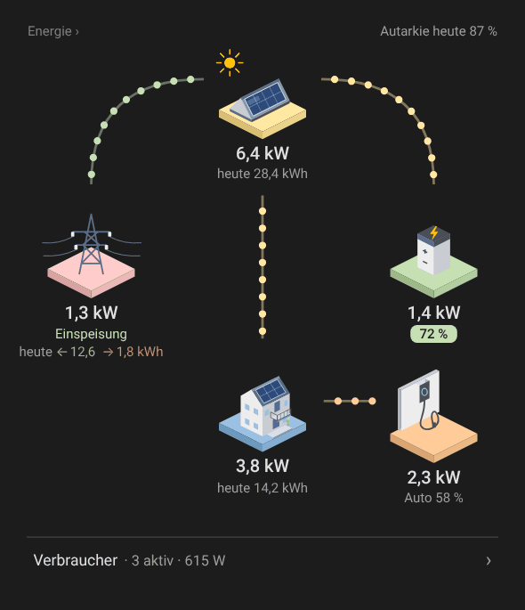
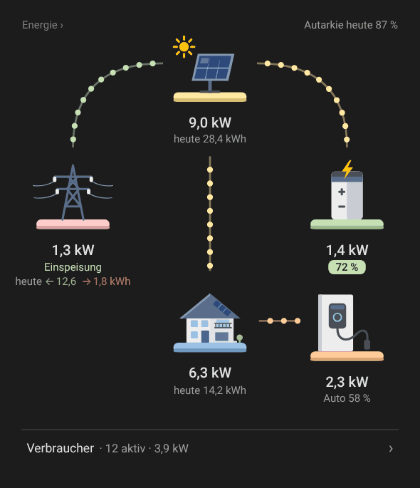

# Energiefluss Card

Eine Home-Assistant-Karte, die den Energiefluss übersichtlich zeigt: PV oben, Netz links, Akku rechts, Haus unten und eine Wallbox, sobald sie lädt. Die Symbole sind isometrische 3D-Bilder, die Linien zeigen nur aktive Flüsse mit langsamer, leistungsabhängiger Animation.

 

Die Vorschau klappt die Verbraucherliste automatisch auf und wieder zu.


## Funktionen

- Fluss-Berechnung aus PV-, Netz-, Akku- und Haussensoren (PV deckt zuerst das Haus, dann den Akku, der Rest geht ins Netz)
- Netz: Bezug rot, Einspeisung grün, Vorzeichen umkehrbar oder getrennte Bezug-/Einspeise-Sensoren
- Akku mit Ladestand, Restlaufzeit („bis 06:40“) aus Kapazität und Mindest-SoC
- Autarkie als Tageswert (aus Netzbezug heute und Hausverbrauch heute oder eigenem Sensor), wahlweise live
- Wallbox wahlweise nur beim Laden, immer oder nie, mit Ladestand des Fahrzeugs
- Einklappbare Verbraucherliste in fester Reihenfolge, nur aktive Verbraucher, mit eigenem Bild oder Symbol
- Tippen, Halten und Doppeltippen mit den üblichen Home-Assistant-Aktionen
- Dezenter Link zum Energie-Dashboard (abschaltbar)
- Symbolstil wählbar: 3D (isometrisch), 2D (flach) oder Linie wie die HA-Icons, Symbole aus [smart-home-icons](https://github.com/LinnFidelius/smart-home-icons)
- Grafischer Editor, gegliedert nach Allgemein, PV, Netz, Akku, Haus, Wallbox und Verbrauchern


## Installation über den Marketplace

Ab Home Assistant 2026.11 (vorher HACS):

1. Einstellungen → Marketplace → „Über Link hinzufügen“
2. Repository: `https://github.com/LinnFidelius/energiefluss-card`, Typ: Dashboard
3. „Energiefluss Card“ installieren und die App neu laden
4. Karte hinzufügen → „Energiefluss“

Mit HACS vor 2026.11 genauso über „Benutzerdefinierte Repositories“.

## Bilder

Alle Symbole sind in die Karte eingebettet, es müssen keine Dateien kopiert werden. Im Editor lässt sich pro Knoten und Verbraucher ein eingebautes Symbol aus der Liste wählen oder ein eigener Pfad eintragen (z. B. `/local/meine-bilder/pv.png`).

In YAML steht `ef:<name>` für ein eingebautes Symbol: `pv`, `netz`, `akku`, `haus`, `wallbox`, `waschmaschine`, `waschmaschine-2`, `trockner`, `kuehlschrank`, `klima`, `tv`, `schreibtisch`, `schreibtisch-2`, `serverschrank`, `heisswasserhahn`, `sprudelhahn`, `zwischenstecker`, `waermepumpe`, `warmwasser`, `gas`, `wasser`, `balkonkraftwerk`, `e-auto`, `geschirrspueler`, `herd`, `mikrowelle`, `kaffeemaschine`, `heissluftfritteuse`, `desktop-pc`, `laptop`, `tablet`, `handy`, `router`, `access-point`, `saugroboter`, `ventilator`, `videoklingel`, `kamera`, `bewegungsmelder`, `temperatursensor`, `fensterkontakt`, `thermostatkopf`, `heizkoerper`, `relais`, `rollladen`, `plotter`, `gluehbirne`, `spot`, `tischleuchte`, `lichtleiste`, `garage`, `haustuer`, `terrasse`, `poolpumpe`, `wischroboter-station`, `rauchmelder`, `wassersensor`, `steckdosenleiste`, `smart-speaker`, `drucker`, `nas`, `switch`, `server`, `backup-server`, `lxc`, `vm`, `windows-vm`, `smart-home`, `dateien`, `fotos`, `medien`, `passwoerter`, `dns-filter`, `reverse-proxy`, `vpn`, `dokumentensuche`, `kontakte`, `kalender`, `ki`, `gameserver`, `sprachchat`, `fabrikspiel`, `tasting`, `kochbuch`, `tanken`, `haushaltsbuch`, `bier`, `wein`, `glas`, `flasche`, `pizza`, `burger`, `pasta`, `salat`, `suppe`, `fruehstueck`, `grillen`, `kuchen`, `weisswein`, `gin`.

## Updates

Neue Versionen erscheinen als GitHub-Release. Der Marketplace zeigt sie als Update an; nach dem Aktualisieren die App bzw. den Browser neu laden.

## Entwicklung

Die SVGs liegen im Ordner `icons`. Nach Änderungen dort `python3 tools/embed_icons.py` ausführen, das schreibt sie in den Block `EF_ICONS` der Karte.

## Beispiel-Konfiguration

```yaml
type: custom:energiefluss-card
pv:
  entity: sensor.pv_power
grid:
  entity: sensor.grid_power
battery:
  soc_entity: sensor.battery_soc
  charge_entity: sensor.battery_charge_power
  discharge_entity: sensor.battery_discharge_power
  capacity_kwh: 7.78
  min_soc: 6
home:
  entity: sensor.house_consumption
wallbox:
  entity: sensor.wallbox_power
  unit: kW
consumers:
  - entity: sensor.washing_machine_power
    name: Waschmaschine
    image: ef:waschmaschine
    threshold: 5
```

## Hinweise

- Code, Symbole und Texte dieses Projekts wurden mit Claude (KI von Anthropic) erstellt und vom Betreiber des Repositorys geprüft und getestet.
- Privates Hobbyprojekt ohne Gewähr und ohne Support-Zusage. Nutzung auf eigene Verantwortung.
- Kein offizielles Home-Assistant-Projekt und mit keinem Gerätehersteller verbunden.
- Die Karte liest nur Sensorwerte aus Home Assistant und sendet keine Daten nach außen.

## Lizenz

MIT, siehe [LICENSE](LICENSE). Gilt für Code und Symbole.
